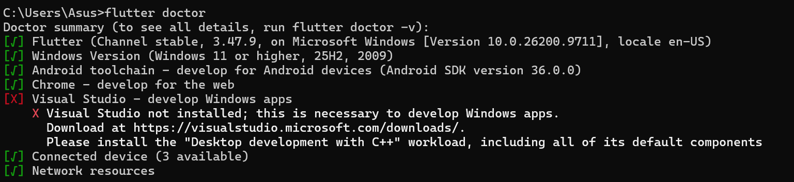
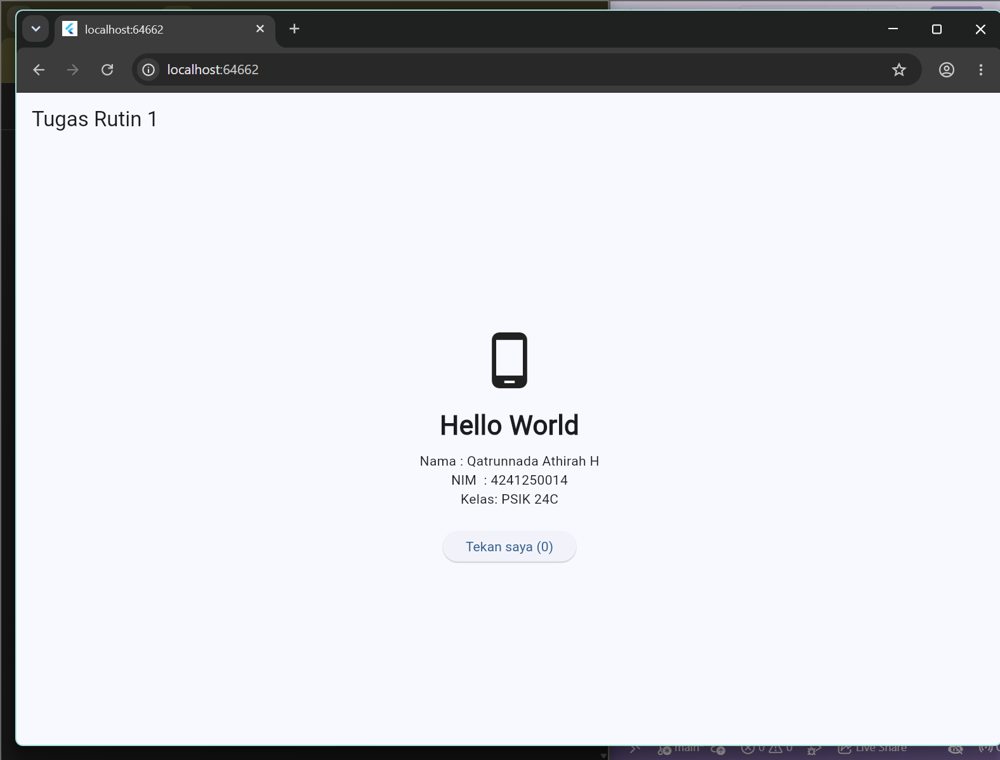

# pm-pertemuan-01-<4241250014>
Hello World Flutter oleh <QATRUNNADA ATHIRAH H> (4241250014), kelas PSIK 24C.

## Versi Flutter
[version](screenshot/version.png) 

## screenshot
- flutter doctor: 
- aplikasi: 

## Kendala & Solusi
1. **Kendala:** Saat menjalankan aplikasi dengan F5 di VS Code muncul error `Unable to find suitable Visual Studio toolchain`, karena target default aplikasi adalah Windows desktop dan Visual Studio dengan workload C++ belum terpasang.
   **Solusi:** Mengganti target perangkat ke Chrome, lalu menjalankan aplikasi dengan perintah `flutter run -d chrome`. --android-licenses`
2. **Kendala:** Mengganti target perangkat ke Chrome, lalu menjalankan aplikasi dengan perintah `flutter run -d chrome`.
   **Solusi:** Masuk ke folder proyek dengan `cd pm_pertemuan_01`, lalu menjalankan ulang perintahnya.

## Pernyataan Penggunaan AI
Saya menggunakan Claude untuk membantu menyusun kerangka kode,
template README. Saya telah membaca, menjalankan, dan memahami
seluruh kode serta menyesuaikan isinya sendiri.